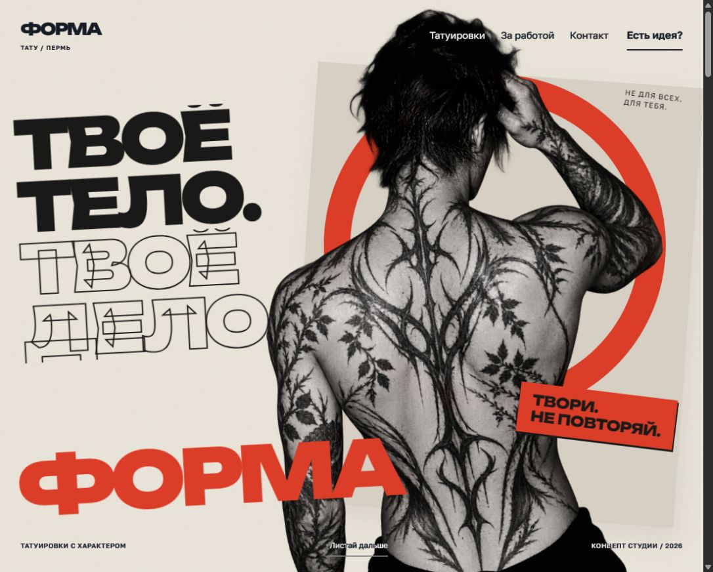

# ФОРМА — концепт тату-студии

[Открыть сайт](https://xiseshtormx.github.io/forma-tattoo/)

Портфолио-проект: выразительный сайт вымышленной тату-студии. Крупная кириллица, бумажный коллаж, чёрно-белая фотография и красные плакатные акценты.

## Возможности

- Многослойный первый экран с анимацией появления и параллаксом.
- Подвижная фотолента на компьютере и вертикальный коллаж на телефоне.
- Крупный просмотр фотографий, клавиатурное управление и возврат фокуса.
- Короткая форма с проверкой полей и подготовкой текста обращения.
- Адаптивная вёрстка и режим уменьшенного движения.

## Технологии

HTML, CSS, JavaScript ES Modules. Локальные шрифты Unbounded и Golos Text; Inter Tight сохранён для базовых стилей. Сборка и сторонние JavaScript-зависимости не требуются. Публикация — GitHub Pages из ветки main, папка /.

## Локальный запуск

Нужен Node.js. Выполните npm run dev и откройте http://127.0.0.1:4173. Проверка JavaScript: npm run check. Установка зависимостей не требуется.

## Статус и материалы

ФОРМА — демонстрационный бренд, не действующая студия. У проекта нет подтверждённых команды, адреса, цен или расписания. Форма готовит текст для копирования: сообщения не отправляются, запись не создаётся.

Главный образ создан ImageGen и не выдаётся за реальную работу салона. В фотоленте и сцене процесса — настоящие фотографии из Pexels и Unsplash. Они не являются портфолио или командой ФОРМЫ. Авторы, источники и лицензии доступны в интерфейсе и в [CREDITS.md](CREDITS.md).

Лицензии шрифтов находятся в папке licenses. Сторонние фотографии и шрифты распространяются на условиях их собственных лицензий.
